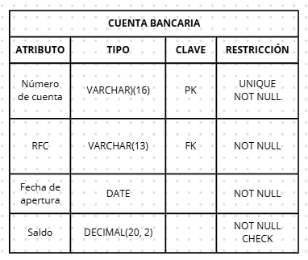
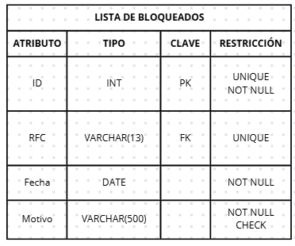
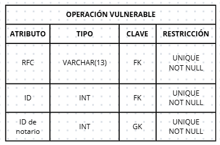
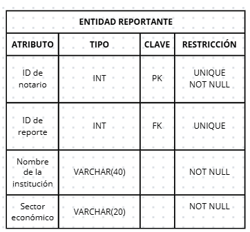
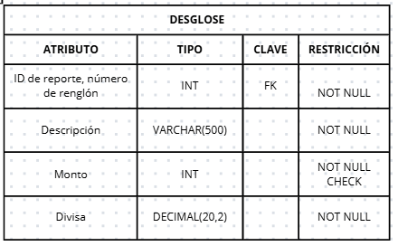
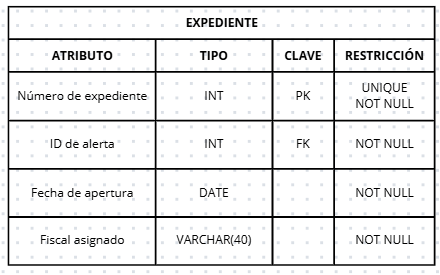
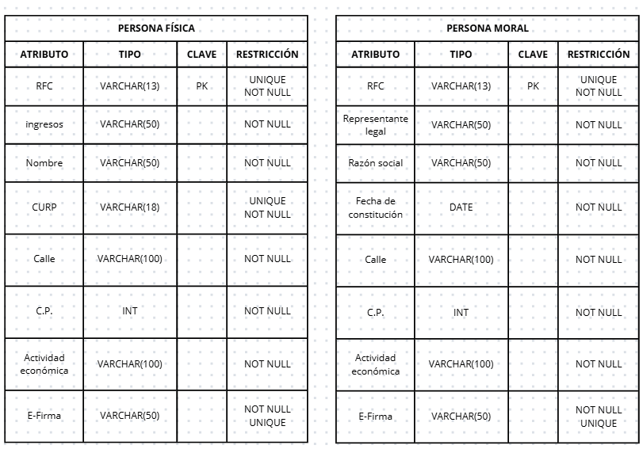

1. Relación "Figura en":
Esta relación, esta relación describe la conexión entre la entidad contribuyente y la lista de bloqueados, en esta relación puede que el contribuyente esté en la lista de bloqueados o no, por lo que es opcional y si está bloqueado entonces figura en una sola lista de bloqueados, al tener una cardinalidad mínima (0,1), entonces pasamos la clave primaria de la obligatoria (contribuyente) a la opcional (lista de bloqueados) con una restricción UNIQUE.
	

2. Relación "Posee":
La relación describe que un contribuyente puede poseer muchas cuentas bancarias, mientras que una cuenta bancaria es poseída por un único contribuyente. De este modo obtenemos una relación (1,N), según las reglas de transformación, la clave primaria del lado uno (contribuyente) se convierte en llave foránea del lado muchos (cuenta bancaria) y con restricción NOT NULL porque es necesario que una cuenta bancaria sea propiedad de mínimo y máximo un contribuyente.

3. Relación "Operación vulnerable":
Esta es una relación ternaria y que además es una relación con cardinalidad muchos a muchos (N:N) que describe la relación entre ENTIDAD REPORTANTE, BIEN y BENEFICIARIO FINAL, en la que ENTIDAD REPORTANTE (notario, etc.) es quien realiza el reporte del bien adquirido por el beneficiario final en la operación vulnerable.

4. Relación "Remite": 
La relación describe la cantidad de reportes que una sola entidad reportante envía a la UIF, es decir, una sola entidad reportante envía muchos reportes a la UIF y la UIF recibe muchos reportes de una sola entidad reportante, por lo tanto es una relación muchos a uno, siguiendo las reglas de transformación, la clave primaria de la obligatoria pasa a ser una foránea de la opcional.

5. Relación "Crea sospecha":
La relación explica que las transferencias entre cuentas bancarias generan una alerta con diferentes niveles de riesgo, puede que una transferencia no genere sospechas o puede que genera muchas de ellas por diferentes motivos, mientras que una alerta pertenece exclusivamente a una sola transferencia. por lo tanto es una relación de (1,N) y la clave primaria de TRANSFERENCIA se convierte en clave foránea de ALERTA.

 

-ENTIDADES DÉBILES Y JERARQUÍAS-

1. DESGLOSE
Esta entidad es débil por identificación, pues no tiene atributos suficientes para tener una clave primaria propia y necesita estar obligatoriamente ligada a REPORTE para poder identificarse; se convierte en una tabla con una clave primaria compuesta por la clave foránea más el discriminante. Cuenta con ON DELETE CASCADE para eliminar los registros de las entidades cuando se requiere que eliminemos una entidad y sus atributos no queden huérfano.

 

2. EXPEDIENTE DE INVESTIGACIÓN
La entidad es débil por existencia porque requiere que exista una alerta para que entonces se cree un expediente de investigación, tiene una cardinalidad estricta (1,1), se convierte en una tabla con clave propia y la foránea de ALERTA.

3. Superclase CONTRIBUYENTE:
Elegimos la tercer estrategia para crear convertís esta jerarquía a MR siguiendo la sugerencia de subclases disjuntas y totales, pues un contribuyente solo puede ser una persona moral o física pero no las dos al mismo tiempo o no ser ninguna; de acuerdo con las reglas de transformación, la tabla de la entidad padre desaparece y se crean dos tablas independientes con los atributos de cada subclase. Al hacer esto, desaparece la tabla de CONTRIBUYENTE.

